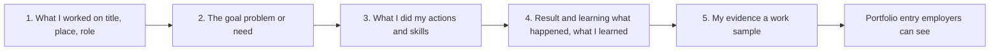

# Experience to Portfolio

**Make your experience visible.**

Created by Dr. Michelle Angelo-Rocha · License: CC BY 4.0

A free guided toolkit that helps students and career changers describe what they have done, identify the skills they practiced, and select evidence to share with employers.

## Why this matters

Employers want proof of skills, not just certificates. Many people have done valuable work in classes, jobs, volunteer roles, and clubs, but struggle to show and explain it. This toolkit helps you turn one experience into a clear portfolio entry.

## The five steps

Start with one experience from a class, job, volunteer role, club, or personal project.

## Build your portfolio entry

### 1. What did you work on?

Give your experience a short title. Describe where it happened and your role.

**Your answer:**

### 2. What was the goal?

What problem, need, or task were you addressing? Who was the work intended to help?

**Your answer:**

### 3. What did you personally do?

Describe your specific actions. For a group project, distinguish your contribution from the team's work. Identify the skills you practiced and explain how you used them.

**Your answer:**

### 4. What happened, and what did you learn?

Describe the result you can support with evidence. If the outcome is unknown or the project is unfinished, say so. Explain what you learned or would improve.

**Your answer:**

### 5. What evidence can you share?

Choose a relevant work sample, such as a presentation, handout, code sample, project plan, or demonstration. Explain what it shows about your contribution. Share only material you have permission to share. Remove personal and confidential information.

**Your answer:**

## Example 1: A cybersecurity club workshop

*Fictional example for illustration.*

**Cybersecurity Club Awareness Workshop**

- **Context and goal:** As a cybersecurity club volunteer, I helped organize a workshop introducing students to phishing warning signs.
- **My contribution:** I coordinated with two presenters, prepared the agenda, and created a handout explaining how to examine suspicious messages.
- **Skills demonstrated:** Coordinating presenters required organization and communication. Creating the handout gave me practice explaining cybersecurity concepts in accessible language.
- **Result and learning:** The workshop took place, and the handout was distributed. We did not measure changes in participants' knowledge. Next time, I would include a short learning activity to check understanding.
- **Evidence:** A sample agenda and the handout, shared with permission, document my planning and educational contributions.

## Example 2: A career changer's past job

*Fictional example for illustration.*

**Improving Password Practices at a Retail Store**

- **Context and goal:** As an assistant store manager, I noticed staff shared one password for the store computer. I wanted to reduce the risk of unauthorized access.
- **My contribution:** I proposed individual accounts to my manager, wrote a one-page guide on creating strong passwords, and walked six coworkers through setting up their accounts.
- **Skills demonstrated:** Spotting the risk showed security awareness. Explaining the change to coworkers built communication and training skills.
- **Result and learning:** Each staff member now logs in with their own account. I did not track incidents before or after. Next time, I would ask the IT provider to confirm the setup.
- **Evidence:** The one-page password guide, with store details removed, shows how I explain security to non-technical people.

## Before you share

Check that your entry accurately represents your role, supports its claims, and includes only information appropriate for public viewing.

## License

Shared under CC BY 4.0. You may use and adapt this toolkit with credit to Dr. Michelle Angelo-Rocha.
